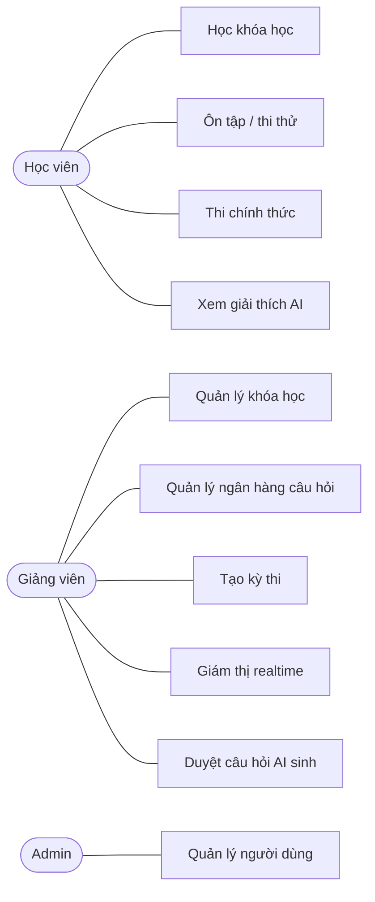

# Đặc tả yêu cầu (bản nháp tuần 1)

Hệ thống học tập và ôn thi trực tuyến tích hợp AI. Đồ án chuyên ngành Công nghệ phần mềm, 14 tuần, một người thực hiện.

## 1. Phạm vi
**Trong phạm vi:** học khóa học, ngân hàng câu hỏi, ôn tập và thi thử, thi chính thức có phục hồi sự cố, giám thị realtime, đúng 3 tính năng AI.

**Tùy chọn (làm nếu còn thời gian):** giám sát qua camera.

**Ngoài phạm vi:** thanh toán, ứng dụng di động, livestream.

## 2. Tác nhân
| Tác nhân | Mô tả |
|---|---|
| Khách | Xem danh sách khóa học, đăng ký tài khoản |
| Học viên | Học, ôn tập, thi thử, thi chính thức |
| Giảng viên | Quản lý khóa học, câu hỏi, kỳ thi; giám thị; duyệt câu hỏi AI |
| Admin | Quản lý người dùng, phân quyền, cấu hình hệ thống |

## 3. Yêu cầu chức năng
| Mã | Yêu cầu | Tác nhân | GĐ |
|---|---|---|---|
| FR-01 | Đăng ký, đăng nhập, làm mới token, đăng xuất | Tất cả | 1 |
| FR-02 | Phân quyền theo vai trò cho từng API | Hệ thống | 1 |
| FR-03 | CRUD khóa học, chương, bài học (video, bài đọc), tài liệu đính kèm | Giảng viên | 1 |
| FR-04 | Ghi danh, lưu tiến độ, học tiếp từ chỗ dừng | Học viên | 1 |
| FR-05 | Lộ trình học, tìm kiếm khóa học | Khách, học viên | 1 |
| FR-06 | Ngân hàng câu hỏi (một đáp án, nhiều đáp án, đúng/sai), gắn chủ đề và độ khó | Giảng viên | 2 |
| FR-07 | Import câu hỏi từ Excel, báo lỗi theo dòng | Giảng viên | 2 |
| FR-08 | Ôn tập theo chủ đề, xem đáp án và giải thích ngay | Học viên | 2 |
| FR-09 | Thi thử tính giờ, tự chấm, sinh đề theo ma trận | Học viên | 2 |
| FR-10 | Thống kê điểm mạnh yếu, sổ tay câu sai | Học viên | 2 |
| FR-11 | Tạo kỳ thi: giờ mở/đóng, thời lượng, danh sách thí sinh, xáo trộn câu và đáp án | Giảng viên | 3 |
| FR-12 | Server giữ giờ và chấm điểm, không gửi đáp án đúng xuống client | Hệ thống | 3 |
| FR-13 | Autosave 5-10 giây, lưu tạm IndexedDB khi mất mạng, khôi phục sau F5 | Học viên | 3 |
| FR-14 | Một phiên hoạt động mỗi lượt thi, nộp bài idempotent, hàng đợi chấm | Hệ thống | 3 |
| FR-15 | Gia hạn thời gian có lý do và nhật ký | Giảng viên | 3 |
| FR-16 | Phát hiện chuyển tab, thoát toàn màn hình, copy/paste; ghi log sự kiện | Hệ thống | 3 |
| FR-17 | Màn hình giám thị realtime, đánh dấu hợp lệ / nghi vấn / vi phạm | Giảng viên | 3 |
| FR-18 | AI sinh câu hỏi từ tài liệu, giảng viên duyệt trước khi vào ngân hàng | Giảng viên | 4 |
| FR-19 | AI giải thích đáp án dựa trên bài học liên quan | Học viên | 4 |
| FR-20 | Gợi ý đề ôn theo chủ đề học viên hay sai | Học viên | 4 |

## 4. Yêu cầu phi chức năng
| Mã | Yêu cầu | Cách kiểm chứng |
|---|---|---|
| NFR-01 | 300 thí sinh đồng thời, nộp cùng lúc không mất bài | Load test k6 (GĐ5) |
| NFR-02 | Mất mạng hoặc F5 giữa giờ thi không mất câu trả lời đã chọn | Kịch bản rút mạng (GĐ5) |
| NFR-03 | Server khởi động lại giữa kỳ thi, thí sinh làm tiếp được | Kịch bản tắt server (GĐ5) |
| NFR-04 | Không API nào trả `is_correct` khi kỳ thi đang diễn ra | Test e2e + rà soát bảo mật |
| NFR-05 | Rate limit đăng nhập và gọi AI | Test e2e |
| NFR-06 | AI lỗi hoặc timeout không làm hỏng chức năng chính, luôn có phương án dự phòng | Test giả lập lỗi AI |

## 5. Use case chính

## 6. Thứ tự cắt khi trễ tiến độ
Camera → tính năng AI thứ ba (FR-20) → sinh đề theo ma trận. Không cắt FR-13, FR-14 và NFR-01..03.
