# ERD (bản nháp tuần 1)

Bao phủ cả 6 giai đoạn để tránh phải đổi schema lớn về sau. Các bảng đánh dấu `[GĐx]` là giai đoạn bắt đầu dùng.

```mermaid
erDiagram
    users ||--o{ refresh_tokens : has
    users ||--o{ courses : "teaches (instructor)"
    users ||--o{ enrollments : enrolls
    courses ||--o{ enrollments : has
    learning_paths ||--o{ learning_path_courses : contains
    courses ||--o{ learning_path_courses : "in"
    courses ||--o{ chapters : has
    chapters ||--o{ lessons : has
    lessons ||--o{ attachments : has
    enrollments ||--o{ lesson_progress : tracks
    lessons ||--o{ lesson_progress : "tracked by"

    courses ||--o{ topics : has
    topics ||--o{ questions : tags
    questions ||--o{ question_options : has
    users ||--o{ practice_attempts : takes
    practice_attempts ||--o{ practice_answers : has
    users ||--o{ wrong_notes : keeps

    exam_blueprints ||--o{ blueprint_rules : "matrix"
    exams }o--|| exam_blueprints : uses
    exams ||--o{ exam_candidates : lists
    exam_candidates ||--o{ exam_attempts : makes
    exam_attempts ||--o{ attempt_questions : "frozen paper"
    attempt_questions ||--o| attempt_answers : answered
    exam_attempts ||--o{ attempt_events : logs
    exam_attempts ||--o{ time_extensions : extended
    exam_attempts ||--o{ submissions : "idempotent submit"

    users ||--o{ ai_jobs : requests
    ai_jobs ||--o{ ai_question_drafts : produces
    ai_question_drafts }o--o| questions : "approved into"

    users {
        uuid id PK
        string email UK
        string password_hash
        string full_name
        enum role "STUDENT | INSTRUCTOR | ADMIN"
        timestamptz created_at
    }
    refresh_tokens {
        uuid id PK
        uuid user_id FK
        uuid family_id "chuỗi xoay vòng, thu hồi cả chuỗi khi token cũ bị dùng lại"
        string token_hash UK "sha256, không lưu token gốc"
        timestamptz expires_at
        timestamptz revoked_at
    }
    courses {
        uuid id PK
        uuid instructor_id FK
        string slug UK "sinh từ tiêu đề, không đổi khi đổi tên"
        string title
        text description
        string thumbnail_url
        bool published "chỉ công bố khi có ít nhất một bài"
    }
    learning_paths {
        uuid id PK
        string title
    }
    learning_path_courses {
        uuid path_id FK
        uuid course_id FK
        int position
    }
    chapters {
        uuid id PK
        uuid course_id FK
        string title
        int position
    }
    lessons {
        uuid id PK
        uuid chapter_id FK
        enum type "VIDEO | READING"
        string title
        string video_url "YouTube hoặc mp4, bắt buộc với VIDEO"
        text content "markdown"
        int duration_sec
        int position
    }
    attachments {
        uuid id PK
        uuid lesson_id FK
        string file_name "tên gốc, giữ tiếng Việt"
        string storage_key UK "tên ngẫu nhiên trên đĩa"
        string mime_type
        int size
    }
    enrollments {
        uuid id PK
        uuid user_id FK
        uuid course_id FK
        uuid last_lesson_id FK "học tiếp từ chỗ dừng"
        timestamptz enrolled_at
        timestamptz updated_at "sắp xếp Khóa học của tôi"
    }
    lesson_progress {
        uuid enrollment_id PK "PK ghép với lesson_id"
        uuid lesson_id PK
        int position_sec "vị trí video gần nhất"
        timestamptz completed_at "null = chưa hoàn thành"
        timestamptz updated_at
    }
    topics {
        uuid id PK
        uuid course_id FK
        string name
    }
    questions {
        uuid id PK
        uuid topic_id FK
        uuid lesson_id FK "bài học liên quan, dùng cho AI giải thích"
        enum type "SINGLE | MULTIPLE | TRUE_FALSE"
        enum difficulty "EASY | MEDIUM | HARD"
        text content
        text explanation
        enum source "MANUAL | IMPORT | AI"
        enum status "DRAFT | ACTIVE | ARCHIVED"
    }
    question_options {
        uuid id PK
        uuid question_id FK
        text content
        bool is_correct "không bao giờ gửi xuống client khi thi"
        int position
    }
    practice_attempts {
        uuid id PK
        uuid user_id FK
        enum mode "TOPIC | MOCK | WEAKNESS"
        int duration_sec
        float score
        timestamptz started_at
        timestamptz finished_at
    }
    practice_answers {
        uuid attempt_id FK
        uuid question_id FK
        uuid[] selected_option_ids
        bool is_correct
    }
    wrong_notes {
        uuid user_id FK
        uuid question_id FK
        int wrong_count
        timestamptz last_wrong_at
    }
    exam_blueprints {
        uuid id PK
        uuid course_id FK
        string name
    }
    blueprint_rules {
        uuid blueprint_id FK
        uuid topic_id FK
        enum difficulty
        int count
    }
    exams {
        uuid id PK
        uuid blueprint_id FK
        string title
        timestamptz opens_at
        timestamptz closes_at
        int duration_sec
        bool shuffle_questions
        bool shuffle_options
    }
    exam_candidates {
        uuid id PK
        uuid exam_id FK
        uuid user_id FK
        enum verdict "VALID | SUSPICIOUS | VIOLATION"
    }
    exam_attempts {
        uuid id PK
        uuid candidate_id FK
        timestamptz started_at "server giữ giờ"
        timestamptz deadline_at "started_at + duration + gia hạn"
        string active_session_id "một phiên hoạt động"
        enum status "IN_PROGRESS | SUBMITTED | GRADED"
        float score
        int version "optimistic lock cho autosave"
    }
    attempt_questions {
        uuid id PK
        uuid attempt_id FK
        uuid question_id FK
        int position
        uuid[] option_order "thứ tự đáp án đã xáo"
    }
    attempt_answers {
        uuid attempt_question_id FK
        uuid[] selected_option_ids
        timestamptz client_saved_at
        timestamptz server_saved_at
    }
    attempt_events {
        bigint id PK
        uuid attempt_id FK
        enum type "TAB_HIDDEN | FULLSCREEN_EXIT | COPY | PASTE | RECONNECT | ..."
        jsonb payload
        timestamptz at
    }
    time_extensions {
        uuid id PK
        uuid attempt_id FK
        uuid granted_by FK
        int extra_sec
        text reason
        timestamptz at
    }
    submissions {
        uuid id PK
        uuid attempt_id FK
        string idempotency_key UK
        timestamptz received_at
    }
    ai_jobs {
        uuid id PK
        uuid user_id FK
        enum kind "GENERATE_QUESTIONS | EXPLAIN | RECOMMEND"
        enum status "PENDING | DONE | FAILED | FALLBACK"
        int tokens_used
        text error
        timestamptz created_at
    }
    ai_question_drafts {
        uuid id PK
        uuid job_id FK
        jsonb payload "câu hỏi + đáp án AI đề xuất"
        enum review_status "PENDING | APPROVED | REJECTED"
        uuid approved_question_id FK
    }
```

## Ghi chú thiết kế
- **Đề thi được "đóng băng"** vào `attempt_questions` lúc bắt đầu làm bài: sửa ngân hàng câu hỏi sau đó không ảnh hưởng bài đang thi, và chấm lại được.
- **Server giữ giờ**: client chỉ hiển thị `deadline_at - now`; mọi lần lưu/nộp sau `deadline_at` (cộng một khoảng ân hạn nhỏ cho độ trễ mạng) bị từ chối hoặc tự nộp.
- **Nộp bài idempotent**: `submissions.idempotency_key` là unique, gửi lại cùng key trả về kết quả cũ.
- **Một phiên hoạt động**: `active_session_id` đổi khi đăng nhập ở thiết bị khác, phiên cũ bị từ chối autosave.
- `attempt_events` dùng `bigint` vì đây là bảng ghi nhiều nhất khi load test.
