# Hướng dẫn sử dụng HTON

HTON là hệ thống học và ôn thi trực tuyến. Mỗi vai trò có một mục riêng bên dưới. Ảnh chụp từ bản chạy ngày 26/11/2026.

- [Học viên](#học-viên): học, ôn tập, thi thử, thi chính thức
- [Giảng viên](#giảng-viên): soạn khóa học, ngân hàng câu hỏi, đề thi thử, kỳ thi
- [Giám thị](#giám-thị): theo dõi phòng thi, gia hạn, phân xử
- [Quản trị](#quản-trị): tài khoản và vai trò

---

## Học viên

### Tìm và ghi danh khóa học
Menu **Khóa học** liệt kê các khóa đã xuất bản. Mở một khóa rồi bấm **Ghi danh miễn phí**. Khóa đã ghi danh nằm ở **Khóa học của tôi**. Menu **Lộ trình** gom nhiều khóa theo thứ tự nên học.

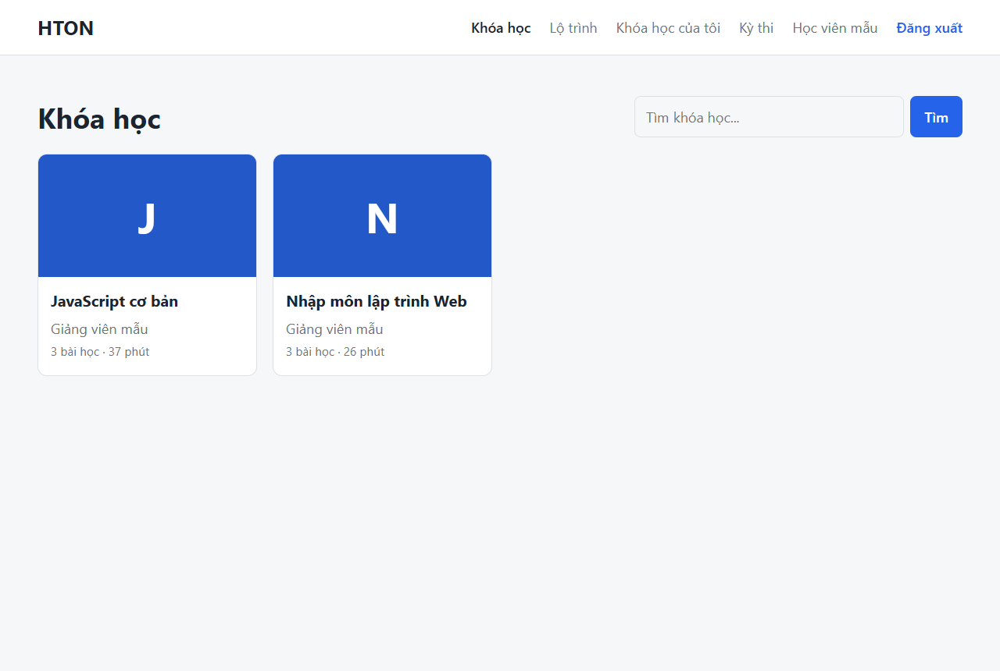

### Học bài
Bài học có thể là bài đọc, video hoặc tệp đính kèm. Học xong bấm **Đánh dấu đã hoàn thành** rồi **Bài tiếp →**. Tiến độ được lưu theo từng bài.

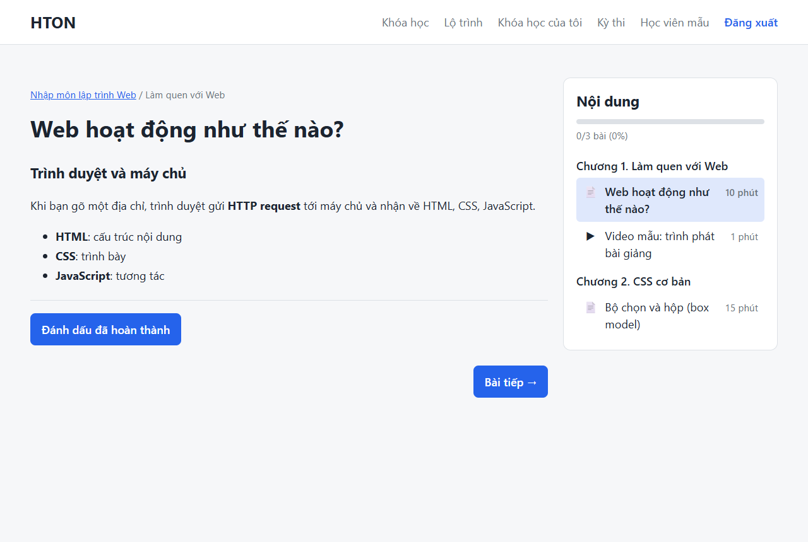

### Ôn tập và thi thử
Trong khóa học, mở **Ôn tập và thi thử**:
- **Ôn tập theo chủ đề:** chọn chủ đề, độ khó, số câu rồi bấm **Bắt đầu ôn tập**. Mỗi câu bấm **Kiểm tra** để xem đúng hay sai ngay. Bấm **✦ AI giải thích** để xem vì sao.
- **Thi thử:** đề theo ma trận của giảng viên, có giới hạn thời gian. Bấm **Bắt đầu thi**, kết quả có sau khi nộp.
- **Gợi ý ôn theo điểm yếu:** sau khi đã làm bài, hệ thống chọn câu ở các chủ đề còn yếu và câu bạn từng làm sai.

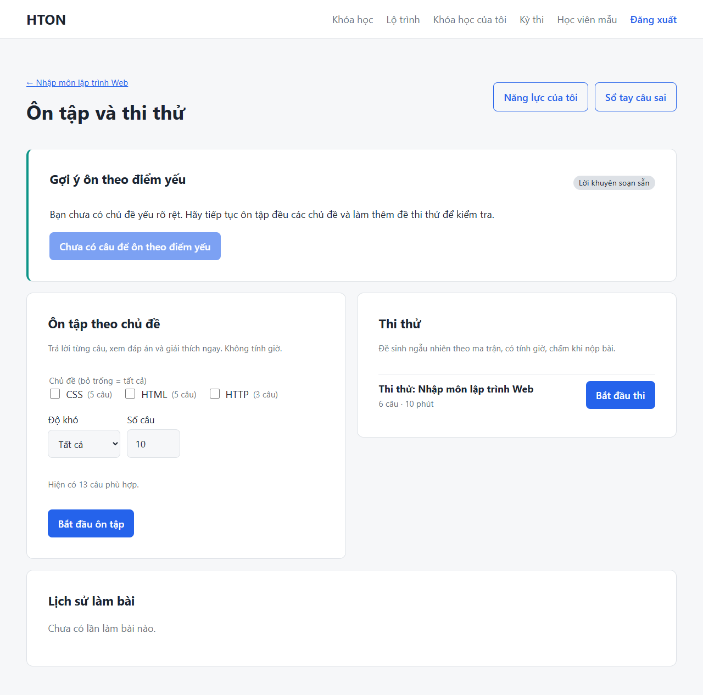
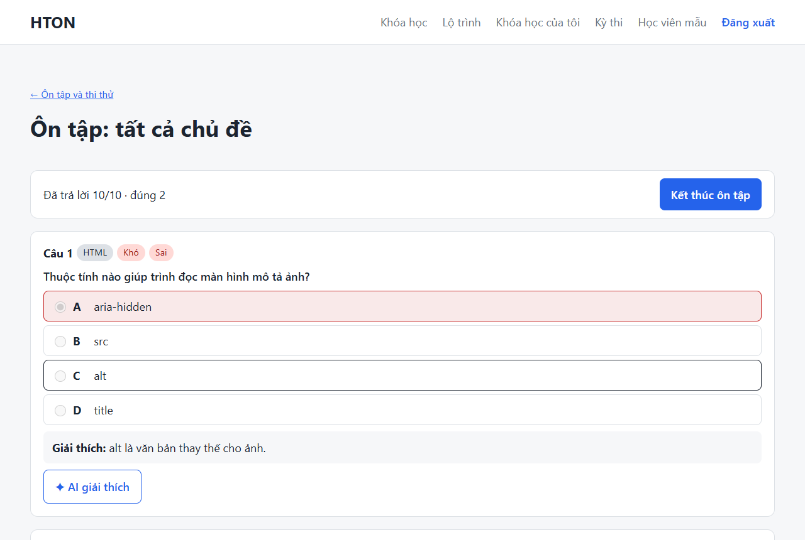

**Năng lực của tôi** cho biết tỉ lệ đúng theo từng chủ đề. **Sổ tay câu sai** liệt kê những câu bạn chưa làm đúng lại.

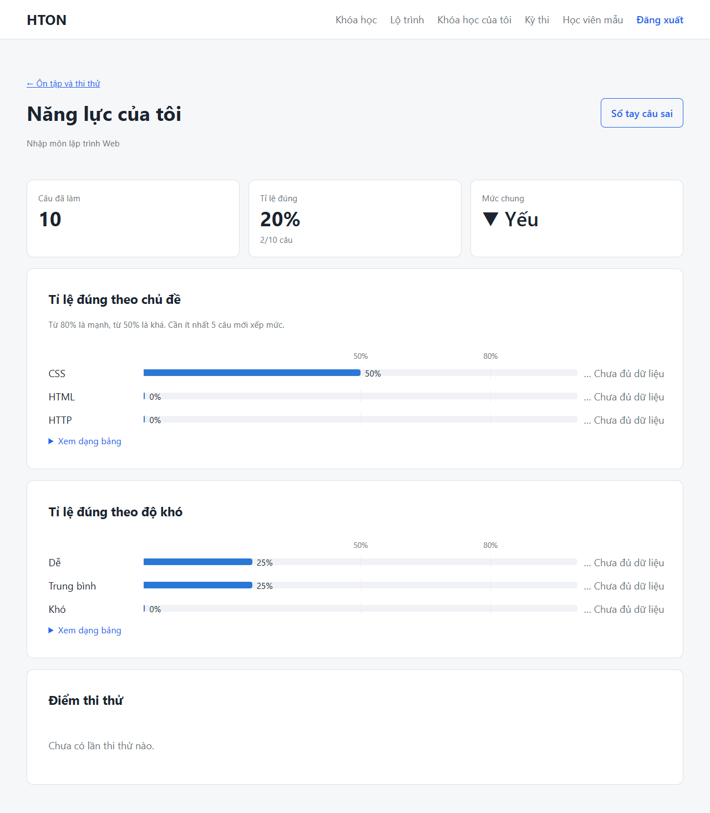

### Thi chính thức
1. Menu **Kỳ thi** liệt kê các kỳ thi bạn được xếp làm thí sinh. Trong khung giờ mở đề, bấm **Vào thi**. **Đồng hồ chạy ngay khi vào bài và chỉ được làm một lần.**
2. Nên bấm **Vào toàn màn hình**. Rời trang, chuyển cửa sổ, copy/paste hay chuột phải đều được ghi lại cho giám thị.
3. Bấm số câu ở thanh trên để chuyển câu. Đáp án được lưu tự động.
4. Làm xong bấm **Nộp bài**. Hết giờ mà chưa nộp thì hệ thống tự nộp. Điểm hiện khi kỳ thi đóng.

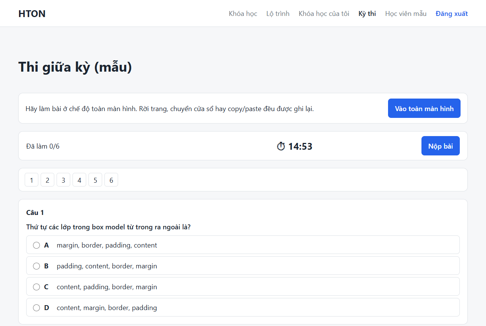

**Khi gặp sự cố trong lúc thi:**
- **Mất mạng:** cứ tiếp tục làm. Đáp án được lưu trên máy và tự gửi khi có mạng lại. **Đừng đóng trang.**
- **Tải lại trang (F5) hoặc trình duyệt bị tắt:** mở lại kỳ thi, bài làm vẫn còn và đồng hồ vẫn chạy theo giờ server. Tải lại trang không bị tính vi phạm.
- **Mở bài thi ở máy hoặc tab khác:** phiên cũ bị khóa, và việc đổi thiết bị được ghi lại như một vi phạm.
- **Mất kết nối lâu:** báo giám thị ngay để được gia hạn (xem mục Giám thị).

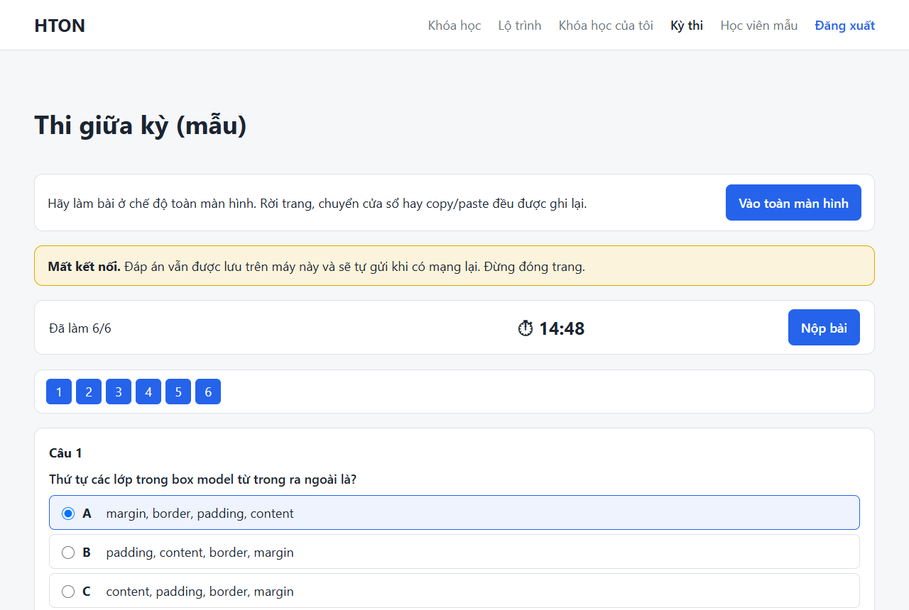

---

## Giảng viên

Menu **Soạn khóa học** chứa các khóa của bạn.

### Soạn khóa học
Tạo khóa, sửa thông tin chung, thêm chương và bài học (bài đọc, video, tệp). Dùng **↑ ↓** để đổi thứ tự. **Xem như học viên** để xem trước. Khóa chỉ hiện với học viên khi đã xuất bản. **Chuyển về nháp** để ẩn khóa.

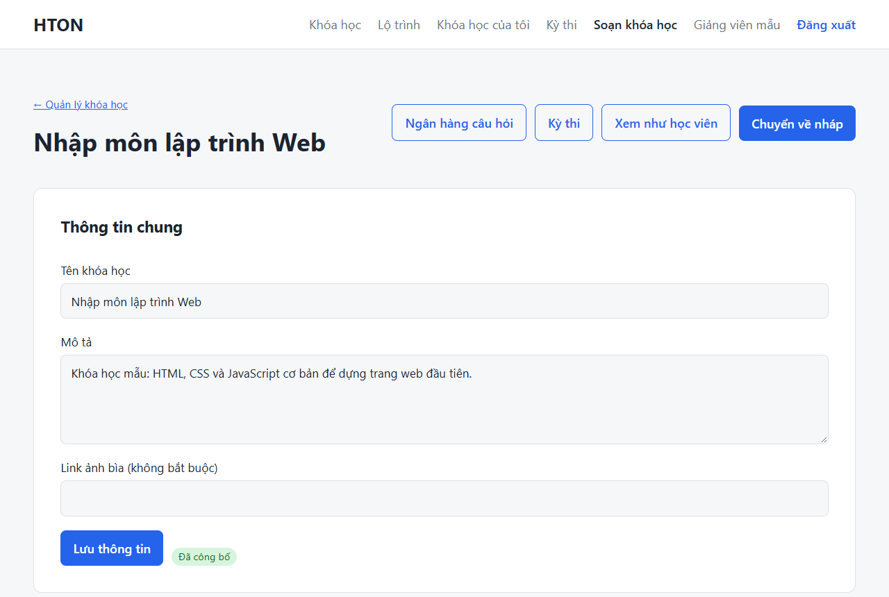

### Ngân hàng câu hỏi
Mỗi câu thuộc một chủ đề và có độ khó (Dễ, Trung bình, Khó). Có ba loại câu: Một đáp án, Nhiều đáp án, Đúng/Sai. Có ba cách thêm câu:
- **+ Thêm câu hỏi:** soạn từng câu.
- **Nhập từ Excel:** tải **file mẫu**, điền rồi bấm **Nhập câu hỏi**. Nếu có dòng sai thì không câu nào được nhập. Hệ thống liệt kê các dòng lỗi để bạn sửa rồi nhập lại.
- **✦ Tạo bằng AI:** chọn chủ đề, độ khó, số câu và nguồn (bài học trong khóa, tệp .pdf/.txt/.md hoặc nội dung dán vào). Câu do AI tạo ở trạng thái **Chờ duyệt (AI)**. Bạn đọc lại, sửa nếu cần rồi bấm **Duyệt**. Câu chưa duyệt không vào đề. Khi hệ thống dùng AI chạy trên máy (Ollama), tệp PDF chưa đọc được: hãy chọn bài học hoặc dán nội dung. Với AI chạy trên máy, khoảng một nửa số câu cần sửa hoặc bỏ, nên đọc kỹ từng câu trước khi duyệt.

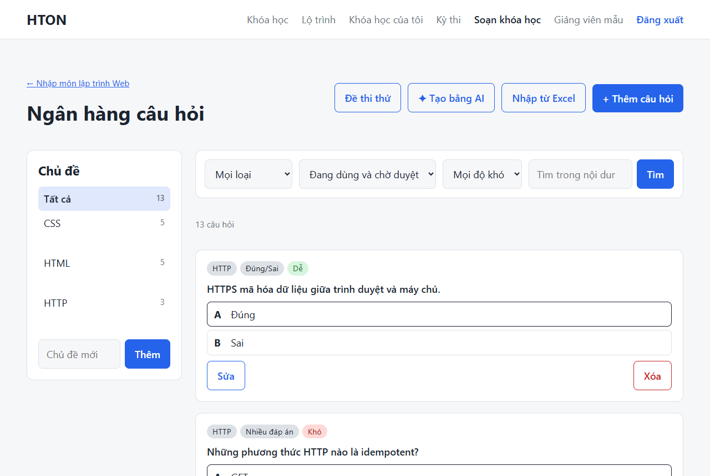
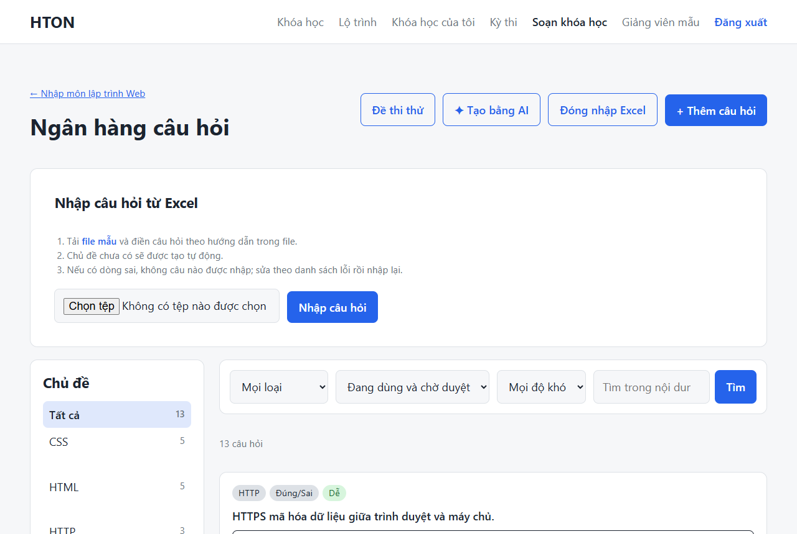
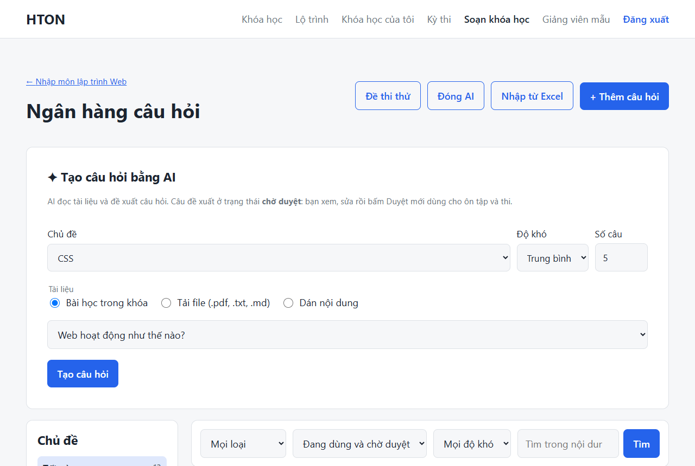

Nếu chưa bật AI (không có API key hoặc mất mạng), tạo câu hỏi bằng AI báo không dùng được và bạn soạn tay. Giải thích đáp án và gợi ý ôn cho học viên vẫn chạy bằng phương án dự phòng.

### Đề thi thử
**Đề thi thử** → **+ Tạo đề**: đặt thời gian và ma trận (mỗi chủ đề, mỗi độ khó lấy bao nhiêu câu). Mỗi lượt thi thử bốc câu ngẫu nhiên theo ma trận.

### Kỳ thi chính thức
**Kỳ thi** → **+ Tạo kỳ thi**: đặt tên, giờ mở đề, giờ đóng đề, thời gian làm, ma trận đề, có xáo trộn phương án hay không. Thêm thí sinh bằng email (cách nhau bởi dấu phẩy hoặc xuống dòng) rồi công bố kỳ thi.
- Đề của mỗi thí sinh được bốc và cố định lúc thí sinh vào thi. Sửa ngân hàng câu hỏi sau đó không làm đổi bài đang làm.
- Khi đã có thí sinh vào thi, không đổi được thời gian làm và không xóa được kỳ thi.

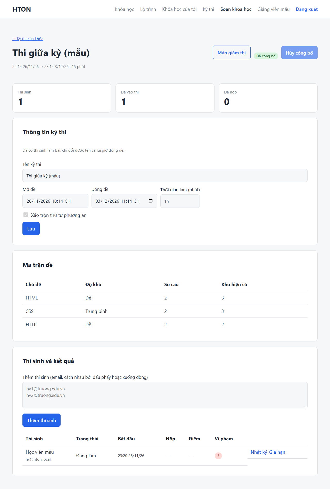

---

## Giám thị

Giảng viên của khóa là giám thị của các kỳ thi trong khóa. Ở trang chi tiết kỳ thi, bấm **Màn giám thị**.

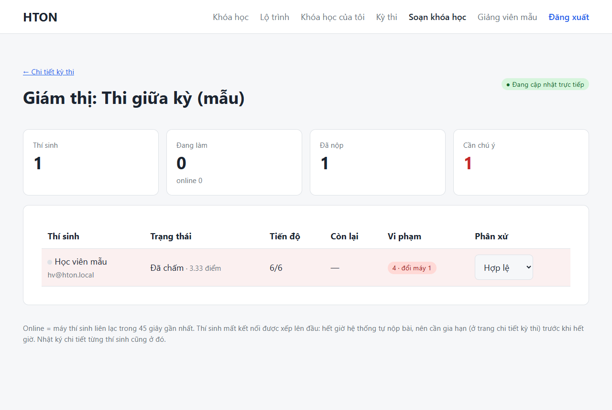

- Góc phải hiện **● Đang cập nhật trực tiếp** khi đã kết nối. Mỗi khi thí sinh lưu bài hay có sự kiện, dòng của thí sinh đó tự cập nhật, không cần tải lại trang.
- **Online** nghĩa là máy thí sinh đã liên lạc trong 45 giây gần nhất. Thí sinh **Mất kết nối** được xếp lên đầu bảng.
- Cột **Vi phạm** đếm các sự kiện rời tab, rời cửa sổ, thoát toàn màn hình, copy/paste, chuột phải, mở bài ở thiết bị khác. Mỗi lần rời tab hoặc cửa sổ tính 1. Tải lại trang không tính.

### Gia hạn: làm **trước khi hết giờ**
Khi thí sinh mất kết nối hoặc gặp sự cố, vào trang chi tiết kỳ thi, bấm **Gia hạn** ở dòng thí sinh đó.

> **Quan trọng:** Bài đã nộp thì **không gia hạn được nữa**. Thí sinh còn mạng thì máy tự nộp đúng lúc hết giờ. Thí sinh mất kết nối thì server chờ thêm 60 giây để máy gửi bù, rồi tự nộp trong vòng 30 giây sau đó (tức tối đa khoảng 90 giây sau giờ hết). Thấy thí sinh mất kết nối thì gia hạn ngay, đừng chờ.

### Nhật ký và phân xử
- **Nhật ký** (ở trang chi tiết kỳ thi) liệt kê từng sự kiện kèm thời điểm. Mục "Rời / tải lại trang" không phải vi phạm nhưng cho biết thí sinh đã rời trang thi lúc nào. Sau đó nếu có khoảng thời gian dài không lưu bài thì cần hỏi lại thí sinh.
- Cột **Phân xử** trên màn giám thị có ba mức: **Hợp lệ**, **Nghi vấn**, **Vi phạm**. Chọn mức khác Hợp lệ thì hệ thống hỏi ghi chú lý do. Số vi phạm tự động chỉ là căn cứ, quyết định cuối cùng là của giám thị.

---

## Quản trị

Tài khoản quản trị mở được trang **/admin/users**: xem danh sách người dùng và đổi vai trò (Học viên, Giảng viên, Quản trị). Không đổi được vai trò của chính mình. Muốn ai soạn khóa học thì đổi người đó sang Giảng viên.
