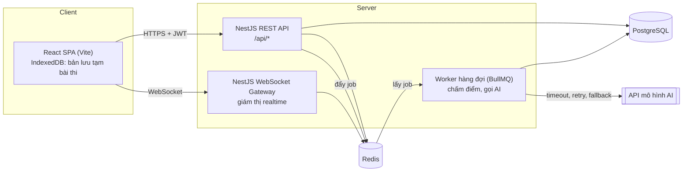

# Kiến trúc (bản nháp tuần 1)

## Thành phần
| Thành phần | Công nghệ | Vai trò |
|---|---|---|
| Frontend | React + TypeScript + Vite | Giao diện học viên, giảng viên, admin, giám thị |
| Backend | NestJS (TypeScript) | REST API, xác thực JWT, phân quyền theo vai trò |
| CSDL | PostgreSQL 16 | Dữ liệu chính (xem [erd.md](erd.md)) |
| Cache / hàng đợi | Redis 7 + BullMQ | Hàng đợi chấm điểm và AI, pub/sub cho WebSocket, rate limit |
| Realtime | Socket.IO qua NestJS Gateway | Màn hình giám thị |
| Triển khai | Docker Compose trên VPS, Nginx/Caddy + HTTPS | Giai đoạn 6 |

## Luồng làm bài thi (giai đoạn 3)
1. Thí sinh bấm bắt đầu → server sinh đề theo ma trận và **đóng băng** (chép câu hỏi, phương án đã xáo, đáp án) vào `attempt_questions`; trả câu hỏi **không kèm đáp án**. Tab gọi start trở thành phiên duy nhất được ghi bài (`active_session_id`).
2. Mỗi lần chọn: ghi ngay vào IndexedDB trên máy rồi gửi lên server (gom 0,4 giây). Câu chưa gửi được thì tự lưu lại mỗi 7 giây và gửi ngay khi trình duyệt báo có mạng (`online`).
3. Mỗi câu gửi kèm `clientSavedAt` (giờ server đã hiệu chỉnh ở client, bị kẹp không vượt giờ server). Server chỉ ghi khi bản gửi mới hơn bản đang có, nên hàng đợi offline cũ không đè lựa chọn mới.
4. Hạn nộp = min(bắt đầu + thời lượng, giờ đóng). Sau hạn server còn nhận đồng bộ 60 giây nhưng **chỉ những câu chọn trước hạn** (trễ tối đa 5 giây); quá 60 giây thì tự nộp.
5. F5 / mở lại trình duyệt → gọi start lấy bài từ server, gộp với IndexedDB theo `clientSavedAt` mới nhất của từng câu rồi gửi bù.
6. Mở bài ở tab/thiết bị khác → phiên mới giành quyền ghi; phiên cũ nhận 409 `SESSION_REPLACED`, dừng ghi và hiện nút "Tiếp tục làm ở đây". Số lần đổi được đếm cho giám thị.
7. Nộp bài chỉ đánh dấu `SUBMITTED` rồi đưa job chấm vào hàng đợi BullMQ (Redis); chấm theo đề đóng băng, idempotent (`SUBMITTED → GRADED` đúng một lần).
8. Job quét mỗi 30 giây: tự nộp bài quá hạn và **xếp hàng lại bài đã nộp mà chưa chấm**, nên server tắt giữa chừng thì bật lại vẫn chấm đủ.
