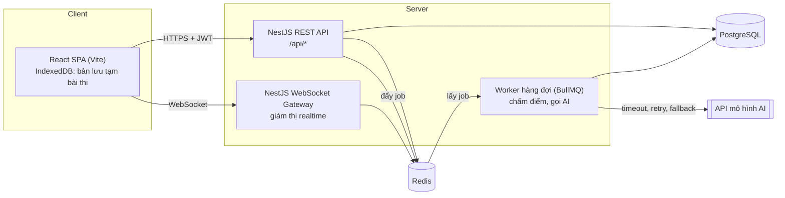

# Kiến trúc (bản nháp tuần 1)

## Thành phần
| Thành phần | Công nghệ | Vai trò |
|---|---|---|
| Frontend | React + TypeScript + Vite | Giao diện học viên, giảng viên, admin, giám thị |
| Backend | NestJS (TypeScript) | REST API, xác thực JWT, phân quyền theo vai trò |
| CSDL | PostgreSQL 16 | Dữ liệu chính (xem [erd.md](erd.md)) |
| Cache / hàng đợi | Redis 7 + BullMQ | Hàng đợi chấm điểm và AI, pub/sub cho WebSocket, rate limit |
| Realtime | Socket.IO qua NestJS Gateway | Màn hình giám thị |
| Triển khai | Docker Compose trên VPS, Nginx/Caddy + HTTPS | Giai đoạn 6 |

## Luồng làm bài thi (giai đoạn 3)
1. Thí sinh bấm bắt đầu → server tạo `exam_attempt`, sinh và đóng băng đề, trả câu hỏi **không kèm `is_correct`**.
2. Client autosave mỗi 5-10 giây; đồng thời ghi IndexedDB. Mất mạng → chỉ ghi IndexedDB, có mạng lại → đồng bộ lên server.
3. F5 → client lấy bài từ server, gộp với IndexedDB theo `client_saved_at` mới nhất.
4. Nộp bài kèm `idempotency_key` → đẩy job chấm vào hàng đợi → trả kết quả khi chấm xong.
5. Hết giờ theo đồng hồ server → server tự nộp với những gì đã lưu.
